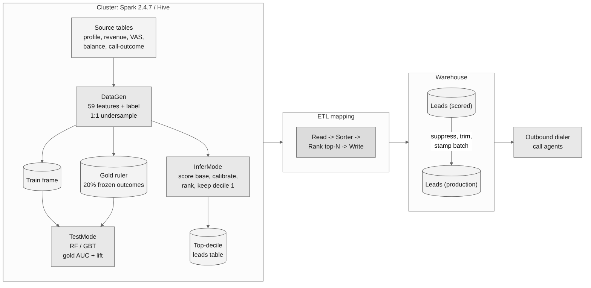

# Insurance VAS Propensity Pipeline

Rank prepaid subscribers by their propensity to buy an insurance value-added
service over an outbound call campaign, and hand the top decile to the dialer.
The model is graded only on real call outcomes (converted vs declined), so a
good score means it ranks buyers above non-buyers, not that it can recognise
people who already hold the product.

This is the **public, sanitised build**. Table and column names are generic, a
synthetic data generator stands in for the warehouse, and random seeds are
fixed, so the whole pipeline runs end to end with no company data. The reported
production numbers (below) come from internal data, not from the synthetic
generator.

## Architecture



Three stages: build the data, train and evaluate on the cluster, deliver the
scored leads through an ETL mapping into the warehouse.

## Features (59 = 43 base + 16 tier)

| Group | n | Examples |
|---|---|---|
| Base: demography, monetary, seasonality | 24 | gender, age, tenure, per-stream totals and daily averages, quarterly / weekday / weekend revenue |
| Base: recency, frequency, cadence | 20 | days since last spend, active days and counts per revenue stream |
| Base: categorical (indexed) | 4 | district, DSD, device type, hardware type |
| Tier-1 VAS affinity | 6 | distinct packages, transactions, total deducted, recency, tenure, active flag |
| Tier-3 prior-insurance | 4 | prior transactions, total, recency, ever-held flag |
| Tier-5 balance | 6 | average, min, max, std, reading count, low-balance share |

VAS features exclude the target insurance packages, and the feature window never
overlaps the label window, so the label cannot leak into the features.

## How to run

```bash
pip install -r requirements.txt

python synthetic_data.py     # writes ./data/*.parquet   (set SYN_N to scale)
python datagen.py            # writes ./out/train_frame, ./out/gold_frame
MODEL=gbt python test_mode.py   # gold AUC + decile lift for GBT
MODEL=rf  python test_mode.py   # baseline ensemble on the same frame
python infer_mode.py         # writes ./out/scored_top_decile (calibrated, decile 1)
```

All knobs (table names, windows, package codes, calibration constant, model
hyperparameters, seeds) live in `config.py`. To run against a real warehouse,
change the body of `load` / `save` in `common.py` to `spark.table` /
`saveAsTable` and point the names in `config.py` at your tables; nothing else
changes.

## Expected output and reproducibility

`test_mode.py` prints `num features: 59` and a gold AUC with a per-decile lift
table. The checklist for a correct run:

- [x] **num features = 59** (43 base + 16 tier)
- [x] **gold AUC** reported on the frozen ruler, not the training label
- [x] **decile-1 lift > 1** and a monotone-ish gradient down the deciles
- [x] **gold AUC not far above the base model** — a jump toward 0.9+ on this
      ruler means a feature is leaking the label; investigate before trusting it
- [x] fixed seeds in `config.py`, dependencies in `requirements.txt`

On the synthetic data the exact AUC depends on `SYN_N` and the seed; the point
of the public build is that the pipeline runs and the method is transparent.

## Results on internal data

| Metric | RF (baseline ensemble) | GBT (shipped) |
|---|---|---|
| Gold AUC | 0.6715 | **0.6735** |
| Top-decile lift | ~1.5x | **1.55x** |

The honest ruler scores ~0.67. Grading the same model on whether it can spot
existing subscribers (billing-vs-base) scores ~0.91 and is discarded as a
leakage check, not a result.

## Repository layout

```
config.py           central configuration (names, windows, packages, seeds)
common.py           Spark session + table IO
features.py         43 base features + the three tiers
synthetic_data.py   schema-matched synthetic source tables
datagen.py          label, gold freeze, negatives, 59-feature frames
test_mode.py        train RF/GBT, gold AUC + decile lift
infer_mode.py       score live base, calibrate, rank, export decile 1
docs/architecture.png
```

## Note on data and privacy

No names, NIC numbers or addresses are used as features; identifiers serve only
as internal join keys. The public repository contains only sanitised code and
synthetic data. Use of the internal data is subject to employer approval.
